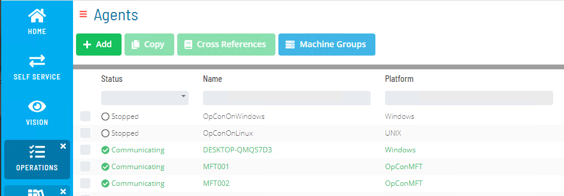
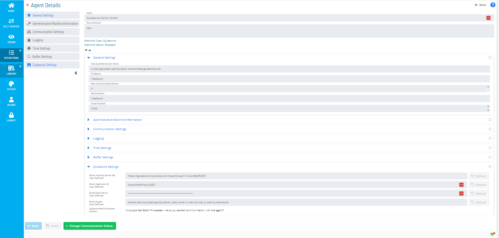

# GuideWire Agent installation

## What is it?

The GuideWire Agent installation configures the connection between OpCon and a GuideWire Service Center (PolicyCenter, BillingCenter, or ClaimCenter). The agent uses an AgentProxy component embedded in SMANetCom to communicate with the GuideWire REST API using OAuth authentication.

- Complete this installation when setting up OpCon to automate GuideWire batch processes for the first time
- Repeat this installation for each GuideWire Service Center that OpCon will connect to, as a separate agent definition is required for each environment
- Complete this installation before creating any GuideWire task definitions in OpCon

GuideWire requires OpCon version 22.8 or greater.

:::warning
Before starting an installation, you must obtain an updated OpCon license key that includes the GuideWire Agent type. Failure to obtain the updated license key will result in a license violation when the defined GuideWire Agent is activated in OpCon and will result in OpCon termination if the activated GuideWire Agent is not deactivated within the specified time.
:::

The OpCon GuideWire environment consists of the AgentProxy that provides the communication link between OpCon and the GuideWire applications.

The AgentProxy is contained within the SMANetCom environment and is installed automatically when the core SMA OpCon component is installed.

The AgentProxy uses the SMANetCom REST API module and provides the communications link between OpCon and the GuideWire REST API. Currently, there is a one-to-one relationship between an OpCon environment and a GuideWire application, meaning a separate AgentProxy instance must be configured for each GuideWire application environment.

## Authentication

GuideWire uses OAuth, which is an open standard authorization framework for token-based authorization on the internet. It acts as an intermediary on behalf of the end user, providing the third-party service with an access token that authorizes specific account information to be shared. The process for obtaining the token is called an authorization flow.

In order to authenticate with your GuideWireCloud instance, a GuideWireCloud OAuth account must first be created.

Consult GuideWire documentation or support to create the required account.

Once you have created the GuideWireCloud OAuth account you will have a set of credentials containing the fields needed for OpCon to communicate with the GuideWireCloud instance:

- Application ID
- Client Secret
- Auth Server URL

However, before setting up the OpCon GuideWire connection, the permission scopes allocated to OpCon must be defined.

### Configuring GuideWire permission scopes

This requires creating a YAML file containing the allocated permissions and storing it in your GuideWireCloud source repository.

Each Service Center will require its own copy of this file, although the same file can be used for each service.
For each Service Center, this file should be located in ***ServiceCenterName***/modules/configuration/config/integration/roles/. This directory should contain many other **.role.yaml** files for reference.

The file name should be a recognizable name without spaces or special characters and suffixed with **.role.yaml** (for example, scp.cc.sasma_stanalone.role.yaml — see figure 1).

The file contains permissible endpoints and must contain the **/systemtools/v1/\*\*** endpoint.

```

name: scp.cc.sasma_stanalone
endpoints:
- endpoint: /claim/v1/**
  methods:
  - GET
  - POST
  - PATCH
  - DELETE
- endpoint: /admin/v1/**
  methods:
  - GET
  - POST
  - PATCH
  - DELETE
- endpoint: /async/v1/**
  methods:
  - GET
  - POST
  - PATCH
  - DELETE
- endpoint: /common/v1/**
  methods:
  - GET
  - POST
  - PATCH
  - DELETE
- endpoint: /systemtools/v1/**
  methods:
  - GET
  - POST
  - PATCH
  - DELETE
accessibleFields:
  "*":
    edit:
    - "*"
    view:
    - "*"

```
Figure 1: Fully permissive role file example

The file contains the following three major fields (Table 1):

Field                   | Description
----------------------- | -----------
**name**                | This is the value used as the filename without the .role.yaml suffix
**endpoints**           | Describes the endpoint for which the subsequent methods are permitted (glob patterns are supported). See **endpoint** information (Table 2)
**accessibleFields**    | Describes the specific fields which the GuideWireCloud API will return to OpCon. For specific details, reference the GuideWire Cloud documentation (Figure 2 contains a default definition that should be used for proper OpCon integration)

Table 1: role.yaml major values

```
accessibleFields:
  "*":
    edit:
    - "*"
    view:
    - "*"
```
Figure 2: Definition for proper OpCon integration

Each endpoint must be separately defined within the endpoints section and contains the endpoint name as well as which methods are allowed.

Field                   | Description
----------------------- | -----------
**endpoint:**           | Defines the endpoint values `/admin/v1/**`, `/async/v1/**`, `/claim/v1/**`, `/common/v1/**`, `/systemtools/v1/**`
**methods**             | Defines the methods allowed on the endpoint: DELETE, GET, PATCH, POST

Table 2: role.yaml second-level values

Once the file has been created, it must be committed to your GuideWireCloud repository. Remember that each Service Center that must be integrated with OpCon will need its own file.
Once the file has been committed, you will be able to reference the newly-created scope from within OpCon.

Consult GuideWire documentation or support to commit the information into your GuideWireCloud repository.

## Agent definition

Before a task can be selected, the agent definition for the connection to the GuideWire environment must be defined. A separate GuideWire agent must be defined for each Service Center that OpCon will connect to.

To define a GuideWire agent, complete the following steps:

1. From Solution Manager, select **Library** and under the **Administration** menu select **Agents**.

   

2. Select **+ Add** to configure the new GuideWire agent.

3. Enter a name for the agent and select **Guidewire** from the **Machine Type** list.

4. Open the **General Settings** section and enter the domain name of the GuideWireCloud Service Center which OpCon will connect to in the **Fully Qualified Domain Name** field. All other settings can be left as the default value.

5. Select the **Save** button.

   

6. After saving, a new section titled **Guidewire Settings** will be available. Expand this section to display four input fields and one informational field.

7. Enter your GuideWireCloud credentials into the appropriate fields.

   Field                            | Value
   -------------------------------- | -----------
   **OAuth Authorize Server URL**   | The value returned when the GuideWireCloud OAuth account was created
   **OAuth Application ID**         | The value returned when the GuideWireCloud OAuth account was created
   **OAuth Client Secret**          | The value returned when the GuideWireCloud OAuth account was created
   **OAuth Scopes**                 | This consists of several names separated by spaces (example: `tenant.sasma project.gwcp planet_class.lower cc.service scp.cc.sasma_stanalone`)
    tenant name                     | Your GuideWireCloud Tenant name (example: `tenant.sasma`)
    GuideWireCloud Project name     | Your GuideWireCloud project name (example: `project.gwcp`)
    GuideWireCloud Planet Class     | Your GuideWireCloud Planet Class (example: `planet_class.lower`)
    Service Center identifier       | The Service Center identifier to be associated with this agent. For Claims Center, enter `cc.service`; for Policy Center, enter `pc.service`
    The created scope file          | The scope file which you created earlier. Enter the name of the scope file without the .role.yaml suffix (example: `scp.cc.sasma_stanalone`)
   **Supported Batch Processes**    | Initially this field will display **No supported Batch Processes - have you started communication with the agent?**

   Table 3: GuideWire Settings fields

8. Select the **Save** button.

9. After confirmation that the save was successful, mark the machine Up.

10. After a short while (a page refresh may be necessary), the **Supported Batch Processes** field will update to display a list of all batch processes the agent is capable of automating. This indicates successful completion of the OAuth configuration for your agent.

## FAQs

**What version of OpCon is required to use the GuideWire Agent?**

OpCon version 22.8 or greater is required.

**Can one agent connect to multiple GuideWire Service Centers?**

No. There is a one-to-one relationship between an OpCon environment and a GuideWire application. A separate agent definition must be created for each Service Center.

**What is OAuth and why is it needed?**

OAuth (Open Authorization) is an open standard framework for token-based authorization. GuideWire uses OAuth to authenticate third-party services such as OpCon, ensuring that only authorized integrations can access the GuideWire APIs.

**What should I do if the Supported Batch Processes field still shows "No supported Batch Processes" after configuration?**

Verify that the machine status has been set to Up and refresh the page. Also confirm that the OAuth credentials and scopes are correctly entered in the GuideWire Settings section, and that the role.yaml file has been committed to the GuideWireCloud repository.

**Is the AgentProxy installed separately?**

No. The AgentProxy is contained within the SMANetCom environment and is installed automatically when the core SMA OpCon component is installed.

## Glossary

**AgentProxy** — The communication component within the SMANetCom environment that provides the link between OpCon and the GuideWire REST API. Installed automatically with the core SMA OpCon component.

**Authorization flow** — The process by which OAuth obtains an access token for a third-party service. In the context of the GuideWire Agent, this is the sequence of steps that allows OpCon to authenticate with the GuideWireCloud instance.

**OAuth (Open Authorization)** — An open standard authorization framework for token-based authorization. GuideWire uses OAuth to authenticate third-party integrations such as OpCon.

**role.yaml** — A YAML configuration file stored in the GuideWireCloud source repository that defines the permission scopes granted to OpCon for a specific Service Center.

**Service Center** — A GuideWire application environment — PolicyCenter, BillingCenter, or ClaimCenter — with which OpCon communicates through the AgentProxy.

**SMANetCom** — The SMA network communication component that hosts the AgentProxy and manages communication between OpCon and agent machines.
