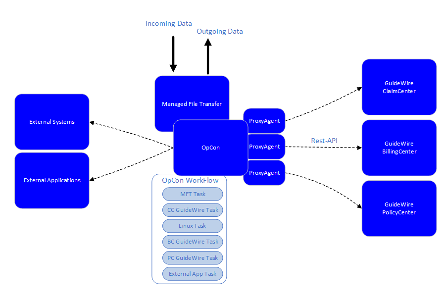

# SMA GuideWire Agent

## What is it?

The SMA GuideWire Agent is an OpCon agent that allows OpCon to schedule Batch Processes within the GuideWire PolicyCenter, BillingCenter, and ClaimCenter environments.

- Use this agent when you need OpCon to schedule and monitor GuideWire Batch Processes as part of a larger automated workflow
- Use this agent to co-ordinate task requirements across GuideWire systems, non-GuideWire systems, and external applications
- Use this agent to retrieve available Batch Processes from a GuideWire Service Center and submit them with optional argument overrides

The SMA GuideWire Agent uses asynchronous calls supported by the REST API Framework to submit Batch Process requests and to track the status of the submitted requests. Available Batch Processes are retrieved from the PolicyCenter, BillingCenter, and ClaimCenter environments and added to a selection list, allowing you to select the appropriate process. If the Batch Process supports arguments, you can define those arguments and they will be submitted with the request.

The advantage of using OpCon to schedule the Batch Processes is that OpCon can co-ordinate task requirements across GuideWire systems, non-GuideWire systems, and external applications, allowing the automation of dependent tasks within workflows.

## FAQs

**What GuideWire applications does this agent support?**

The SMA GuideWire Agent supports GuideWire PolicyCenter, BillingCenter, and ClaimCenter.

**How does the agent communicate with GuideWire?**

The agent uses asynchronous calls supported by the REST API Framework to submit Batch Process requests and track their status.

**Can arguments be passed to Batch Processes?**

Yes. If the Batch Process supports argument specification, you can define argument names and values in the task definition and they will be submitted with the request.

**What other systems can OpCon co-ordinate with when using this agent?**

OpCon can co-ordinate task requirements across GuideWire systems, non-GuideWire systems, and external applications, allowing the automation of dependent tasks within workflows.

## Glossary

**Batch Process** — An automated operation available within a GuideWire Service Center (PolicyCenter, BillingCenter, or ClaimCenter) that can be scheduled and monitored by OpCon.

**GuideWire** — A cloud-based insurance core platform that includes PolicyCenter (for policy management), BillingCenter (for billing), and ClaimCenter (for claims processing).

**REST API Framework** — The interface used by the GuideWire Agent to communicate with GuideWire Service Centers. The agent uses asynchronous calls to submit requests and retrieve status updates.

**Service Center** — A GuideWire application environment — PolicyCenter, BillingCenter, or ClaimCenter — with which OpCon communicates.
