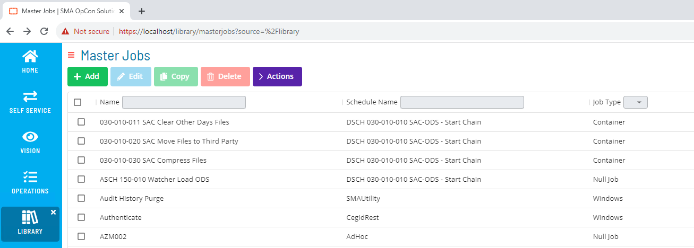
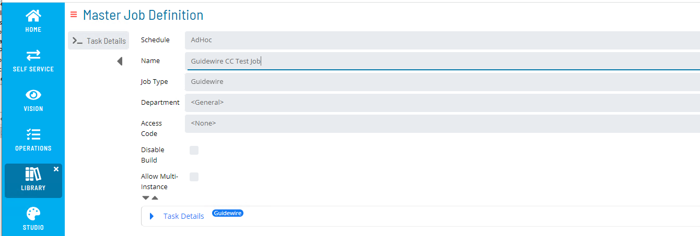
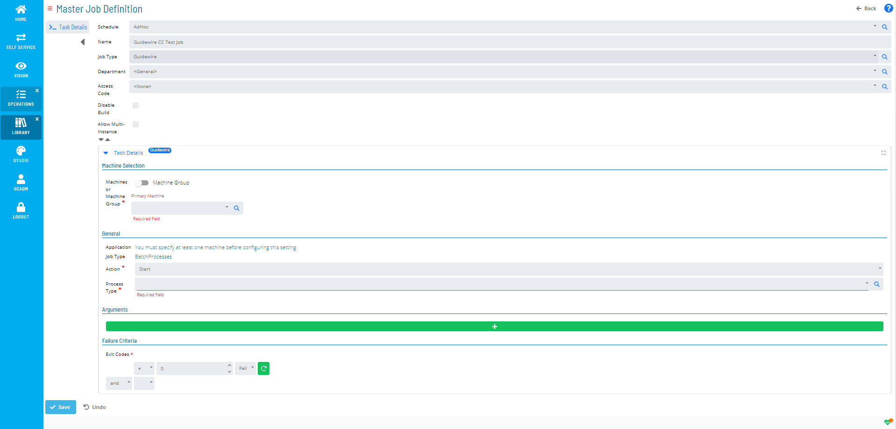
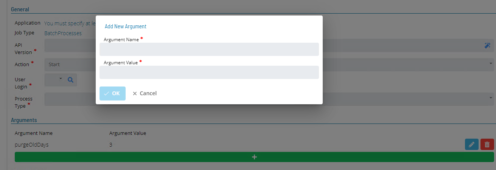

# GuideWire Agent task definition

## What is it?

A GuideWire Agent task definition specifies which GuideWire Batch Process OpCon will run, on which GuideWire machine, and with which optional argument overrides. Task definitions are created and managed in Solution Manager.

- Use a task definition when you need OpCon to start or stop a specific GuideWire Batch Process as part of an automated schedule
- Use the Arguments section when a Batch Process supports override values at startup
- Create one task definition per Batch Process per Service Center — each task targets a single machine and a single process

GuideWire task definitions can only be created or modified using Solution Manager.

## Creating a task definition

To create a new task, complete the following steps:

1. From Solution Manager, select **Library** and from the **Administration** menu select **Master Jobs**. The Master Jobs view is displayed.

   

2. Select the **+ Add** button to create a new task, or use the **Name**, **Schedule Name**, or **Job Type** filters to find an existing task definition.

   

3. Select the associated schedule from the **Schedule** list, enter a unique job name (within the associated schedule) in the **Name** field, and select **Guidewire** from the **Job Type** list. The **Task Details** section will reflect the selected job type **Guidewire**.

## Task details

To configure task details, complete the following steps:

1. Open the **Task Details** field.

   

2. Complete the required definitions in the **General** section.

   Field                            | Value
   -------------------------------- | -----------
   **Machines or Machine Group**    | Select the required GuideWire machine from the list. Machine Group configurations are not currently supported
   **Action**                       | Select the task action from the list. Currently only **Start** and **Stop** actions are supported
   **Process Type**                 | Select the required Batch Process from the list. The list of available Batch Processes is retrieved from the associated GuideWire environment

## Arguments

Some Batch Processes support the capability to provide argument values that override the default Batch Process arguments at startup.

To define override values for the selected Batch Process, complete the following steps:

1. Open the **Arguments** section.

   

2. Select the green **(+)** bar in the **Arguments** section.

3. Enter the argument name in the **Argument Name** field and the argument value in the **Argument Value** field.

4. Select **OK**. The argument information is displayed above the **(+)** bar.

To modify or remove an existing argument, select the icon to the right of the entry in the argument list.

### Argument examples

The **PurgeAsyncApiRequest** Batch Process supports an argument named **purgeDaysOld**, which takes an integer value.

The **DBConsistencyCheck** Batch Process supports an argument named **tableNames**, which takes a string value containing the names of tables to check (for example, `cc_activity,cc_address`). For arguments that accept a list of values, separate the values with commas in the **Argument Value** field. For example, to check two tables titled Table 1 and Table 2, enter `Table 1, Table 2`.

## Failure criteria

Successful completion of the task results in a completion code of `0` being returned to OpCon. Any other value will result in the OpCon task being marked as failed.

## FAQs

**Can I run multiple Batch Processes in a single task definition?**

No. Each task definition targets a single Batch Process. To run multiple Batch Processes, create a separate task definition for each and use OpCon job dependencies to control the execution order.

**What happens if a Batch Process does not appear in the Process Type list?**

The Process Type list is populated from the associated GuideWire machine. If a process is not listed, verify that the agent is running and that communication with the GuideWire Service Center has been established. The Supported Batch Processes field on the agent definition will show which processes are available.

**What is the Failure Criteria?**

OpCon evaluates the exit code returned by the Batch Process to determine whether the task succeeded or failed. An exit code of `0` indicates success; any other value causes OpCon to mark the task as failed.

**Can Machine Groups be used with GuideWire tasks?**

Machine Group configurations are not currently supported. Each task definition must target a specific GuideWire machine.

## Glossary

**Action** — The operation the GuideWire Agent will perform on the selected Batch Process. Currently supported actions are **Start** and **Stop**.

**Arguments** — Optional name-value pairs submitted with a Batch Process request that override the default startup values for that process. Only Batch Processes that support arguments accept these overrides.

**Batch Process** — An automated operation available within a GuideWire Service Center that can be scheduled and monitored by OpCon.

**Failure criteria** — The condition that determines whether an OpCon task succeeded or failed. For GuideWire tasks, an exit code of `0` indicates success; any other value marks the task as failed.

**Process Type** — The specific GuideWire Batch Process that the task definition will run. The available processes are retrieved from the connected GuideWire Service Center.

**Task Details** — The section of a GuideWire Master Job definition where the machine, action, and process type are configured.
